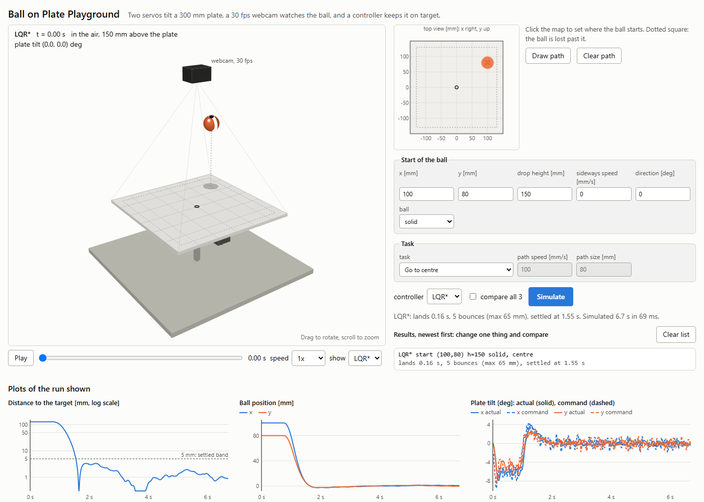
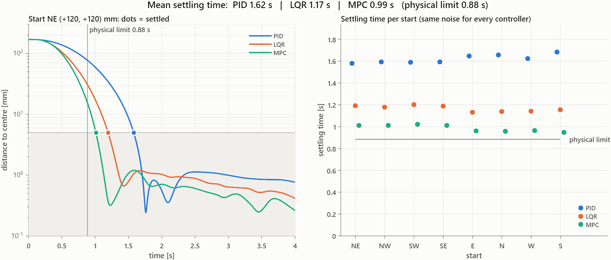
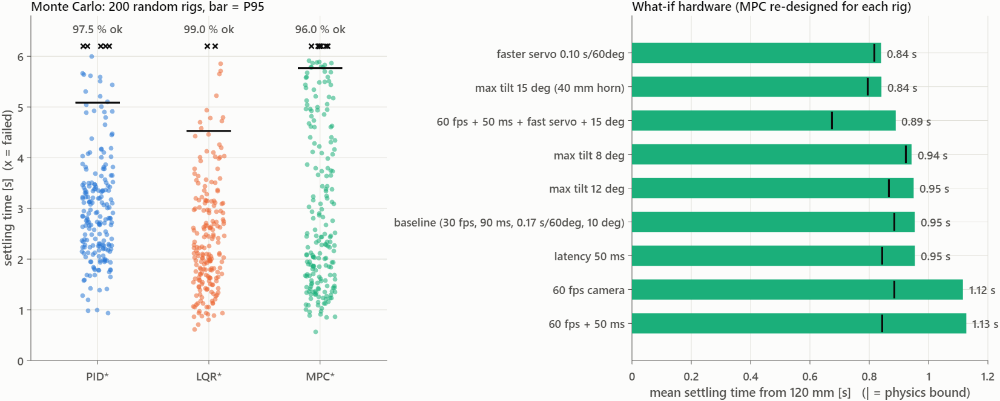
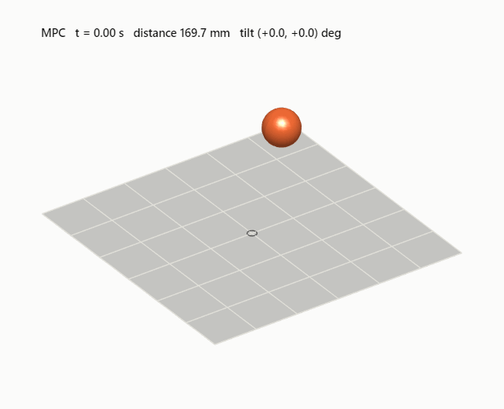

# Ball on Plate: a browser simulator

**[▶ Open the live simulator](https://ahmakaremi1991-tech.github.io/ball-on-plate/web/ball_on_plate.html)**: it runs in your browser, with nothing to install.

Two hobby servos tilt a 300 mm plate, a 30 fps webcam watches the ball, and a controller has to bring the ball to the centre as fast as possible. This page lets you drop the ball, throw it, make it follow a path, and compare three controllers: **PID\***, **LQR\*** and **MPC\***.



The design was done in MATLAB R2025a / Simulink. The page in [`web/ball_on_plate.html`](web/ball_on_plate.html) is a JavaScript copy of that model and its tuned controllers, so you can try it without MATLAB.

---

## How to open it

| Option | What to do |
|---|---|
| **Online** | Click the link at the top of this page. |
| **Offline** | Download [`web/ball_on_plate.html`](web/ball_on_plate.html) (click the file, then the **Download raw file** button) and double-click it. It is one self-contained 75 KB file that needs no internet connection. |

It works in any recent version of Chrome, Edge, Firefox or Safari. It also works on a phone, though the controls are easier to use on a desktop.

---

## Instructions

### 1. Pick where the ball starts
- **Click the top-view map** (top right) to place the ball. The dotted square is the edge: if the ball goes past it, it is **lost**.
- Or type the start in **Start of the ball**:

| Field | Meaning |
|---|---|
| `x`, `y` [mm] | Start position. The plate runs from −150 to +150 mm, and (0, 0) is the centre. |
| `drop height` [mm] | 0 means the ball starts on the plate. Anything higher makes it fall and bounce. |
| `sideways speed` [mm/s] | Throws the ball sideways at the start. |
| `direction` [deg] | Direction of that throw: 0° points along +x, 90° along +y. |
| `ball` | **solid** (rubber or wood) or **hollow** (like a ping-pong ball: bouncier and less responsive to tilt). |

### 2. Pick a task
| Task | What the controller does |
|---|---|
| **Go to centre** | Brings the ball to the centre and holds it there. This is the task the controllers were designed for. |
| **Zig-zag, Circle, Square, Figure-8, Line** | The ball must follow a moving target. Set the target speed with `path speed` and the size with `path size`. |
| **My path** | Press **Draw path**, click points on the map, then simulate. **Clear path** removes the points. |

### 3. Pick a controller and simulate
- Choose **PID\***, **LQR\*** or **MPC\***, or tick **compare all 3** to run all three on the same case.
- Press **Simulate**. A run takes a fraction of a second.

### 4. Watch and compare
- **3-D view:** **Play** / **Pause**, drag the time slider, and change the playback **speed**. Drag the view to rotate it and scroll to zoom. With *compare all 3*, use **show** to switch between the runs.
- **Results list:** every run is added at the top with its landing time, bounce count and settling time. Change one thing at a time and compare.
- **Plots** (below the 3-D view): distance to the target, ball position and plate tilt. Hover over a plot to read its values. **Show the numbers as a table** lists the values every 0.25 s.

### Things to try
1. Use the same start with a drop height of **50 mm**, then **250 mm**.
2. Use a drop height of **150 mm**, first with the **solid** ball and then with the **hollow** one. The hollow ball keeps bouncing much longer, and the controller cannot steer it while it is in the air.
3. Start near an edge and throw the ball **outwards**. Does it stay on the plate?
4. Run the **Zig-zag** at **100 mm/s**, then at **250 mm/s**, with each controller. At 250 mm/s, LQR\* and MPC\* chase the target so hard that the ball overshoots off the plate.
5. Draw your own path and see which controller follows it best.

---

## What is being simulated

| Part | What the model includes |
|---|---|
| **Ball** | Rolling with rolling resistance, plus flight and bounce when dropped. Solid or hollow. |
| **Servos** (MG996R class) | Speed limit (0.17 s/60°), deadband, backlash and 1 µs PWM steps. |
| **Linkage** | 30 mm horn, push rod and lever, with a tilt limit of ±10°. |
| **Camera** | 30 fps with about 90 ms of latency, pixel quantisation, noise and dropped frames. |

### The three controllers
- **PID\***: classic feedback on the camera position. Most of its stability margin has to come from the derivative term because of the camera delay.
- **LQR\***: optimal state feedback with a **Kalman filter that predicts through the 90 ms delay**, plus a small integrator that is active only near the centre.
- **MPC\***: the same filter, but it **re-plans 1.2 s ahead every frame** and knows the tilt and servo-speed limits, which gives near bang-bang moves.

The star (\*) means the controller was **robust-tuned** (surrogateopt + patternsearch) on rigs with random errors in servo speed, latency, friction, plate level and camera calibration.

---

## Results from the MATLAB / Simulink study



| | PID | LQR + Kalman | MPC |
|---|---|---|---|
| Nominal rig, 8 starts at 120 mm | 1.62 s | 1.17 s | 0.99 s |
| Robust-tuned (\*) | 1.41 s | **0.92 s** | 0.95 s |
| **200 random rigs: success rate** | 97.5 % | **99.0 %** | 96.0 % |
| 200 random rigs: median settling time | 2.9 s | **2.1 s** | 2.3 s |

**Physical limit:** from 120 mm, no controller can do better than **0.88 s** given the 10° tilt limit, the servo speed and the 90 ms delay. LQR\* gets within 4 % of that limit.

**Recommendation: LQR\*.** It is as fast as MPC, the most robust of the three, and simple to run on real hardware because it needs no optimisation solver.



**Hardware lesson:** to make the rig faster, buy speed in the **actuator** (a faster servo, or a longer horn for 15° of tilt, each about −0.11 s). A 60 fps camera does not help unless the controllers are retuned for it.

<p align="center"></p>

---

## How far to trust it

- **It matches Simulink.** On 45 reference runs without camera noise, the ball position in the browser differs from Simulink by at most **0.4 mm RMS**, with the same bounce counts and the same lost/not-lost result. With camera noise on, mean settling times agree within **1.3 %**.
- **It is still a simulation, not a measured rig.** The bounciness (0.6 solid, 0.85 hollow) and the sliding friction during a bounce (0.4) are assumed values. A rolling ball never lifts off the plate, and the camera has no parallax for a ball in the air.
- **The controllers were tuned for "go to centre".** Drops, hollow balls and path following are outside what they were tuned for, which is why fast zig-zags can lose the ball.

---

## Repository layout

```
web/ball_on_plate.html   the simulator (one self-contained file)
docs/images/             screenshot and result plots used in this README
index.html               redirects the Pages root to the simulator
```
